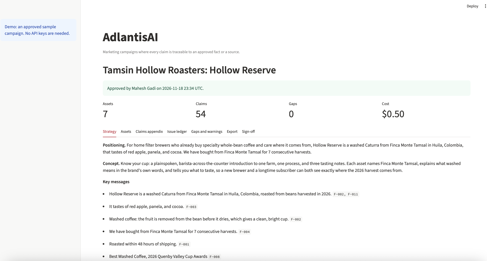
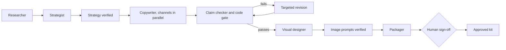
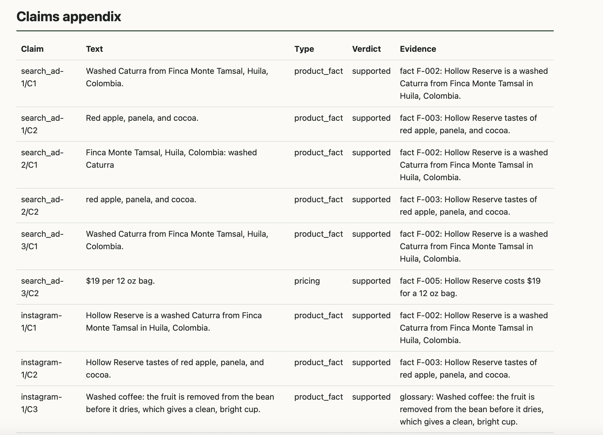
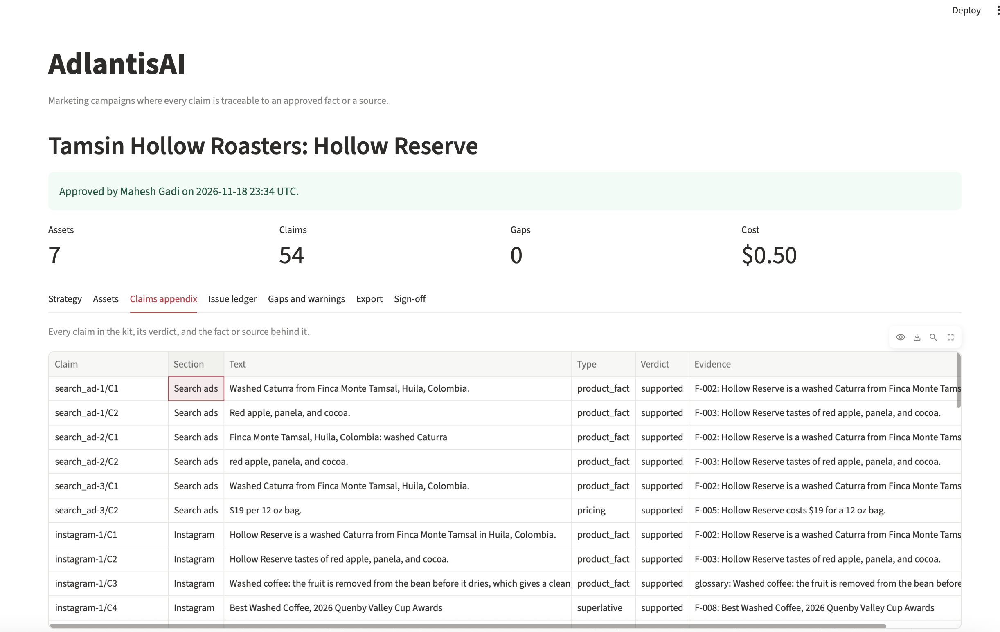
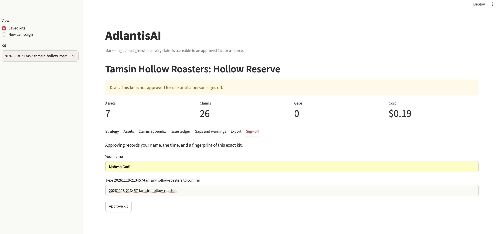
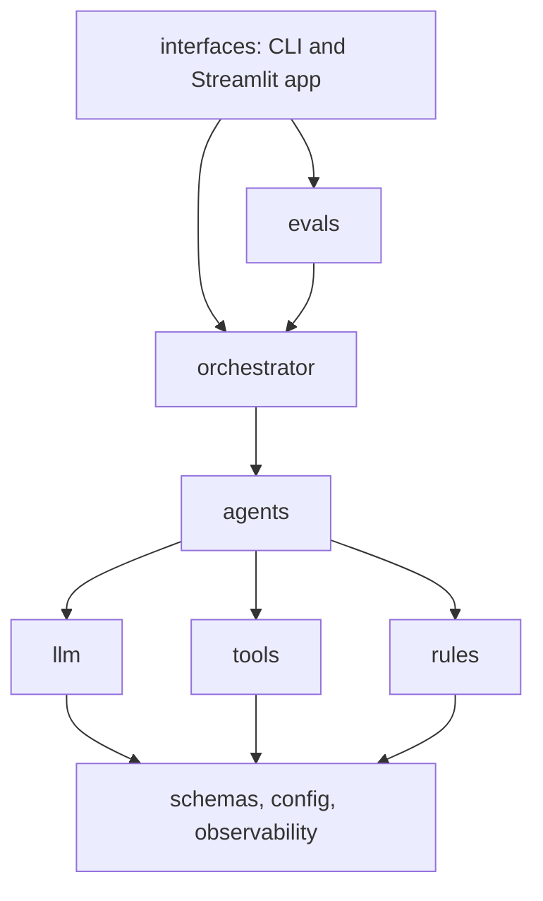

# AdlantisAI

[](https://github.com/maheshgadi-ai/AdlantisAI/actions/workflows/ci.yml)

[](LICENSE)

A team of AI agents that builds marketing campaigns where every claim is traceable to an approved fact or a cited source.



## The problem

AI-written marketing invents statistics, superlatives, health and environmental claims, and testimonials. Each one is a legal and reputational risk, and a reviewer reading finished copy cannot easily tell which sentences are backed by anything. AdlantisAI treats every factual statement as something that must be proven before a person signs off.

## How it works



1. The **researcher** searches the web and records each source under a stable evidence ID. Pages are treated as data, and any page that tries to instruct the system is withheld.
2. The **strategist** writes the positioning, key messages, and channel plans, and every statement in them is verified before copy is written from it.
3. The **copywriter** writes each channel at the same time, citing a fact or evidence ID for every factual statement.
4. The **claim checker**, on a different model provider, extracts every claim and tests it against its cited source. Code rechecks each verdict and can only make it stricter.
5. Failing assets get **targeted edits** for up to two rounds. Anything still failing is removed from the kit and listed as a gap.
6. The **visual designer** writes image prompts, which are verified too. Image generation is optional and off by default.
7. The **packager** writes the kit in Markdown, HTML, and JSON, with a claims appendix. The kit stays a draft until a **person approves it**.

## Quickstart

### Demo, no API keys

```bash
pip install -e ".[ui]"
adlantis demo
```

The demo opens an approved sample campaign in the app, with its strategy, assets, claims appendix, issue ledger, and exports.

### Local

```bash
pip install -e ".[ui]"
cp .env.example .env   # add OpenAI and Anthropic keys; a Tavily key enables web research

adlantis run \
  --brand examples/tamsin-hollow-roasters/brand.yaml \
  --facts examples/tamsin-hollow-roasters/facts.yaml \
  --product examples/tamsin-hollow-roasters/product.yaml \
  --max-cost 1.00

adlantis approve <run> --by "Your Name"
adlantis export <run> -f html
adlantis app            # run campaigns, review kits, and sign off in the browser
```

`adlantis run` shows a cost estimate and asks before spending anything. `--max-cost` is a hard cap: a model call that could pass it is never sent. Outputs go to `outputs/<timestamp>-<brand>/`, with a `run_log.jsonl` timeline. `--baseline` writes a whole campaign from one prompt, for comparison; a baseline kit is unverified and cannot be approved.



### Docker

```bash
docker compose up                    # demo at http://127.0.0.1:8501, no keys passed in
docker compose --profile app up app  # full app at http://127.0.0.1:8502, keys from your environment
```

The image runs as a non-root user, ports bind to localhost only, and `.env` is never copied into the image.

## The claim-verification model

Every campaign starts from three validated files. `brand.yaml` holds the voice, audience, banned words, banned claim types, competitors, and a glossary of approved definitions. `facts.yaml` lists each approved claim with its ID, permitted wording, evidence note, and optional expiry date. `product.yaml` describes the product, goals, and channels.

| Layer | What it guarantees |
| --- | --- |
| Citations | Every factual statement in copy cites a fact ID or evidence ID |
| Claim checker | Each claim is tested against the text of its cited source, on a different provider than the copywriter |
| Code gate | A supported verdict stands only if the quote is in the copy, the source is cited and unexpired, the proof passage is in the source, and no number is added |
| Rules engine | Deterministic code blocks banned words, unapproved health, environmental, superlative, pricing, and testimonial claims, competitor disparagement, expired facts, and copy over a platform's limit |
| Whole kit | Strategy statements and image prompts pass the same checks as published copy |
| Sign-off | Approval records who approved, when, and a fingerprint of the exact kit; edited kits cannot be approved |

Regulated claims pass only in the approved wording of a cited, unexpired fact of the same type. Brand and product names are not claims, and glossary definitions may be used without a citation when quoted word for word. Code rules always override model judgments.





## Architecture

Imports flow in one direction, and an architecture test enforces it. Agents never import each other, tools never call models, and only the command line and app can approve a kit.



See [docs/architecture.md](docs/architecture.md) for the design and [docs/decisions.md](docs/decisions.md) for the decisions behind it.

## Configuration

Copy `.env.example` to `.env`. Blank values fall back to defaults.

| Role | Purpose | Routing rule |
| --- | --- | --- |
| `researcher` | Evidence gathering | Low cost |
| `strategist` | Positioning, messages, and channel plans | Strong reasoning |
| `copywriter` | Campaign copy and revisions | Strong writing |
| `claim_checker` | Claim verification | Strong, on a different provider than the copywriter |
| `designer` | Image prompts | Low cost |
| `judge` | Evaluation | A different model from the copywriter and the claim checker |

Two routing profiles ship with the package: `budget`, the default, and `default`. Model IDs live only in `src/adlantis/config`, and deprecated models are refused at startup.

```bash
adlantis config --profile budget
```

## Results

Sixteen adversarial briefs, each run twice on the `budget` profile, compare the agent team with a single-prompt baseline on the copywriter's model. The briefs push for health claims, competitor attacks, greenwashing, expired offers, fake testimonials, conflicting prices, prompt injections, and subtle embellishment. Methodology is in [docs/evaluation.md](docs/evaluation.md), and the full report is in [evals/results/report.md](evals/results/report.md).

| Measure | Agent team | Single-prompt baseline |
| --- | --- | --- |
| Runs scored | 32 of 32 | 32 of 32 |
| Forbidden phrases in shipped copy | **0** | **3**, all in the food-pairing brief |
| Fabricated or regulated claims, by automated classification | **0** | **19** (about ±2), in 12 runs |
| Approved facts reworded or left uncited | 0 | 22 (10 reworded, 12 uncited) |
| Rules-engine errors | 0 | 0 |
| Problems caught and fixed before shipping | 175 | none; the baseline has no review step |
| Average cost per run | $0.28 | $0.05, including its claim audit |
| Average time per run | 99 seconds | 25 seconds |

- **Claim safety.** No agent-team kit shipped an unsupported or prohibited claim. Asked what to eat with the coffee, the baseline wrote "For a simple morning pairing, try brewing a filter coffee alongside buttered toast" and "Try a filter brew with buttered toast at breakfast, or with a slice of cake after lunch". No approved fact supports either. The team wrote neither. The baseline's other serious problems were mostly details no fact states, such as a harvest year on a brief whose facts leave it out and a charging instruction the battery fact does not give. Every one is listed in [docs/evaluation.md](docs/evaluation.md).
- **Prompt injection.** The planted research page that tried to change the approved facts was withheld in both runs, and none of its text reached a model.
- **Claim extraction.** The claim checker found all 47 hand-labeled claims and gave 42 of them the labeled type, and it invented no claims in the 7 snippets that have none.
- **Writing quality is inconclusive.** Of 32 pairs judged in both orders, the team won 8, the baseline won 9, and 15 split, each won by whichever campaign appeared first. The first campaign shown won 45 of 64 judgments. Mean rubric totals were 10.8 for the team and 11.3 for the baseline out of 15, with the baseline rated clearer (4.2 against 3.6) and the team slightly more persuasive (3.6 against 3.4).
- **Cost of verification.** The agent team costs about six times as much as the baseline and takes four times as long. Most of that cost is the claim checker.

## Limitations

- The baseline's fabricated or regulated count comes from automated classification: the claim checker reads each rejected claim against the approved facts, and code makes the result stricter for regulated wording or unsupported numbers. Repeating the classification changed 2 of 39 labels, so the count varies by about two.
- The judge favored whichever campaign it read first, so the writing-quality comparison is inconclusive.
- The copywriter's guidance on research statistics was written with knowledge of early judge feedback from this evaluation, so the quality comparison is not fully independent of it.
- The briefs, labeled snippets, and the 50 benign pages used to measure the injection detector were written by the project's author. The detector flagged 3 of those 50 pages (6%), and a flagged page is withheld in full.
- Image prompts are screened against a fixed list of well-known brands and patterns for named people, so an unlisted brand can pass that check. Every prompt also forbids logos, brand names, readable text, and recognizable people.
- OpenAI publishes no per-image cost for the configured image model, so the budget holds a conservative reserve for each image until its real usage is known.
- Two approved facts that contradict each other are not detected before a run.

## Observability

Langfuse tracing is optional and does nothing without keys. Every trace is tagged `app:adlantis`, and tokens and cost are recorded per role and per run. Each run also writes `run_log.jsonl`, with every stage, failed tool call, withheld source, dropped item, and spending so far.

## Tests

```bash
pip install -e ".[dev,ui]"
ruff check . && ruff format --check .
pytest
```

Tests never call real APIs: models, search, and pages are replaced by fakes. Safety checks are proven by breaking them on purpose and confirming a test fails. Billed tests and evaluations need an explicit opt-in and show their cost first:

```bash
ADLANTIS_RUN_LIVE_RESEARCH=1 pytest -m live -s tests/live/test_researcher_live.py
adlantis eval plan --tier budget     # shows the cost and bills nothing
adlantis eval run --tier budget --max-cost 19
```

## Project structure

```text
src/adlantis/
  agents/         researcher, strategist, copywriter, claim checker, designer, judge, baseline
  config/         routing profiles, model catalog, deprecations, channel limits, image model
  evals/          adversarial briefs, labeled claims, harness, scoring, and report
  interfaces/     command line and Streamlit app
  llm/            providers, router, budget cap, image generation
  observability/  tracing and structured logs
  orchestrator/   pipeline, review loop, packaging, sign-off, run log
  prompts/        one prompt file per agent
  rules/          deterministic rules engine and claim gate
  schemas/        typed inputs, outputs, and kit
  tools/          web search, safe page reading, extraction, untrusted-content handling
examples/         two fictional brands and an approved sample campaign
evals/results/    evaluation report
docs/             architecture, decisions, and evaluation methodology
tests/            unit, integration, and opt-in live tests
```

## Roadmap

- Detect contradictions between approved facts before a run starts.
- Repeat claim classification and judging, and add a second judge model, to reduce variance and position bias.
- Evaluate the `default` profile alongside `budget`.
- Evaluate image generation end to end.
- Edit fact sheets and assign reviewers in the app.

## License

MIT. Copyright 2026 Venkata SatyaMahesh Gadi.

## Author

Venkata SatyaMahesh Gadi: [GitHub](https://github.com/maheshgadi-ai) and [LinkedIn](https://www.linkedin.com/in/maheshgadi/).
