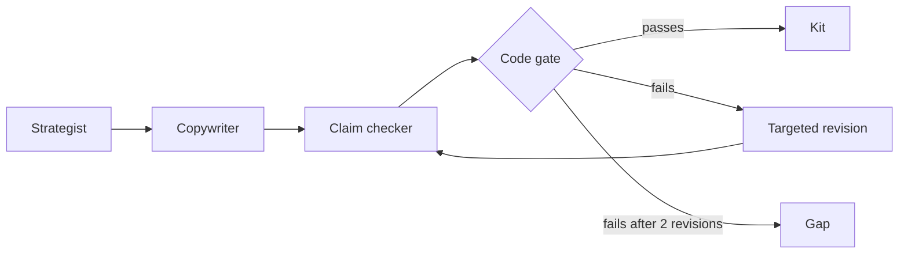
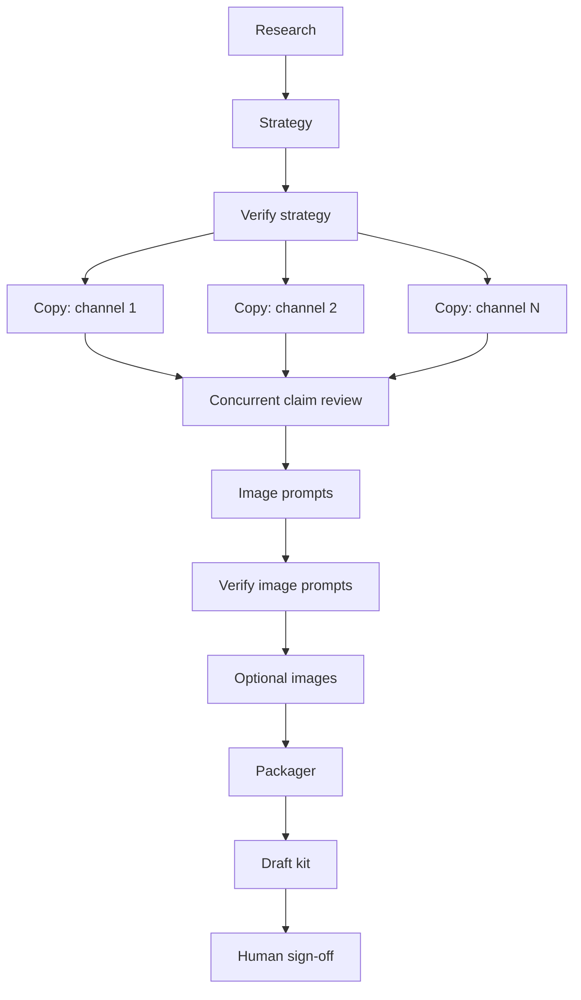
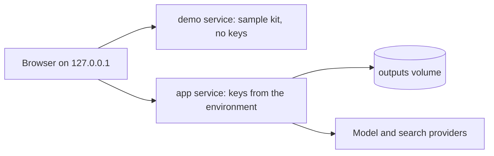

# Architecture

## Layers

Imports only flow downward. `tests/test_architecture.py` fails the build on any violation.

| Rank | Packages | Responsibility |
| --- | --- | --- |
| 7 | `interfaces` | Command line and app |
| 6 | `evals` | Evaluation harness, which drives the orchestrator |
| 5 | `orchestrator` | Pipeline, concurrency, and budget |
| 4 | `agents` | One model-backed step per agent |
| 3 | `llm`, `tools`, `rules` | Provider access, research tools, and the deterministic rules engine, independent of each other |
| 2 | `observability` | Tracing and structured logging |
| 1 | `schemas`, `config`, `prompts` | Typed records, settings, and prompt files |

Agents never import each other, and tools never call models.

## Model routing

Agents ask the router for a role and never name a model. Model IDs live only in `src/adlantis/config`. At startup the router checks the resolved routing, including environment overrides, and refuses to run when the claim checker shares a provider with the copywriter or the judge matches a model it grades.

## Rules engine

`rules/` is deterministic code with no access to models, the network, or the system clock. The date is passed in, so the same copy always produces the same result.

| Rule | Blocks |
| --- | --- |
| `banned_word` | Words on the brand's list, in any case, spacing, or plural form |
| `banned_claim_type` | Claim types the brand never makes, even when a fact supports them |
| `health_claim` | Health and medical claims |
| `environmental_claim` | Environmental and ethical-sourcing claims |
| `superlative_claim` | Claims of being the best, first, only, or top |
| `pricing_claim` | Prices, offers, financing, and guarantees |
| `testimonial_claim` | Customer quotes, ratings, reviews, and endorsements |
| `competitor_disparagement` | Criticizing or comparing against a competitor |
| `channel_limit` | Copy over a field's length limit, and fields a channel does not have |
| `expired_fact` | Citing or repeating a fact after its expiry date |
| `unknown_reference` | Citing a fact or evidence record that does not exist |

A regulated claim passes only when the asset cites an unexpired approved fact of the same type and uses that fact's approved wording verbatim. A price may also be restated on its own when the amount and currency match the cited fact. Competitor disparagement and banned claim types have no exemption.

Text is normalized before matching, so invisible characters, full-width letters, and lookalike punctuation cannot disguise a phrase.

Channel limits carry a severity. Limits a platform enforces by rejecting copy are errors and block the asset. Truncation guidelines and editorial limits are warnings: they are reported in the kit and never block, and they remain the length the copywriter aims for. Instagram and LinkedIn have both a hard post cap and a shorter "see more" point. `config/channel_limits.yaml` records each limit's severity, its source, and whether that source is a third party.

## Research

The researcher finds market trends, competitor angles, and audience insights. Each source enters an append-only evidence store under a stable ID such as `E-4`, with a source-quality rating. The same text from the same page keeps its ID, and changed text receives a new one, so a citation always refers to the same words.

## Campaign writing and verification

The strategist cites a fact or evidence ID for every key message. The copywriter lists each factual statement with its sources. The claim checker runs on a different provider and proposes a type and verdict for every claim.

Code has the last word and can only make a verdict stricter. A claim stays `supported` only when all of these hold:

- The quote appears in the copy, and the copy cites that source for that statement.
- Every cited source exists, is unexpired, and is usable.
- The supporting passage appears in the cited source, and the claim adds no numbers.
- A regulated claim cites an approved fact of the same type. Web evidence never qualifies.
- A fact approved for exact wording is not reworded.
- No rule violation overlaps the claim, and the brand does not ban its type.

A cited statement the checker never assessed fails closed.

Failing assets return to the copywriter with their issue IDs. Each edit replaces one exact passage, so a revision cannot rewrite an asset. Work continues from the best version so far, and a worse revision is discarded. After two revision rounds, any asset still failing is removed from the kit and listed as a gap.

## Orchestration

| Concern | Behavior |
| --- | --- |
| Concurrency | Channels are written together and assets are reviewed together, up to `--concurrency` at a time. Results keep a stable order. |
| Retries and timeouts | `orchestrator/policy.py` sets limits per agent. Research is never repeated, because a repeat would bill its searches again. A budget stop is never retried. |
| Budget cap | Each call holds the most it can cost before it is sent. Calls wait while others hold money they need, and a call that cannot fit is refused unsent. Searches and images count toward the cap. |
| Failure | A failed channel or asset becomes a gap and the run continues. A run with no strategy or no copy stops without a kit. |
| Run log | `run_log.jsonl` records each stage, failed tool calls with their cause, dropped work, and spending so far. Anything shaped like an API key is removed. |

## Packaging and sign-off

The packager is code. It re-checks every asset and leaves out any with an unsupported claim, a blocking rule violation, or a claim with no traceable source. Those assets are listed as gaps. Strategy statements and image prompts pass the same claim checker, code gate, and rules engine, and a kit containing an unverified statement cannot be built or approved.

Each kit carries a SHA-256 fingerprint of its content. `adlantis approve` requires a person to type the run name, then refuses a kit that changed after packaging, a kit with a replaced image, a baseline kit, an empty kit, or a kit that is already approved. The approval records who signed off, when, and the fingerprint they approved. Only the command line can reach this step: an architecture test keeps it away from agents, tools, and the pipeline.

The HTML page is standalone. All text is escaped, only plain web links are rendered, and a content security policy blocks scripts and outside resources.

## Visual design

The designer writes one prompt per shipped asset, except text-only search ads. Code rejects prompts that request real people, real brands, logos, or the campaign's own names, and adds standing restrictions to every prompt. Prompts are checked again immediately before image generation.

## Untrusted content

Fetched web content is data and is never treated as instructions. Independent layers enforce this:

| Layer | Guarantee |
| --- | --- |
| Address checks | `fetch_url` accepts only public http(s) addresses and re-checks every redirect |
| Extraction | Scripts, comments, and text a reader cannot see are removed |
| Sanitizing | Invisible and control characters are removed |
| Quarantine | A source containing instruction-like text is kept for audit, withheld from models, and cannot be cited |
| Boundaries | Remaining web text reaches the model only as tool output inside an unpredictable boundary |
| Read allow-list | Only URLs returned by search in the current run can be read, so a page cannot direct the model elsewhere |
| Narrow output | The researcher can return findings and gaps only, and receives neither the fact sheet nor any tool that changes state |
| Grounding | Code rejects a finding unless its quote appears in usable cited evidence and its numbers come from those sources |

The last three layers hold even when a manipulative sentence goes unrecognized or a model is persuaded by it. Research findings are market context, never approved claims: citing web evidence does not exempt copy from the rules engine.

## Interfaces

| Interface | Purpose |
| --- | --- |
| `adlantis run`, `approve`, `export` | Run a campaign or baseline, sign off on a kit, and export it |
| `adlantis app` | The Streamlit app: campaign form with a cost estimate, live run timeline, kit viewer, sign-off, and downloads |
| `adlantis demo` | The app in read-only mode on the approved sample campaign, with no API keys |
| `adlantis eval` | Plan, run, complete, and re-score evaluations |

The app shows the cost estimate before a run and starts only after the cost is accepted and the needed keys are set. It runs the campaign in a worker thread and streams run-log events to a live timeline. Sign-off asks for the reviewer's name and the run name typed in full.

The Docker image runs as a non-root user with no new privileges, and compose publishes ports on localhost only. The demo service receives no keys. The app service reads keys from the environment when it starts and writes runs to the `outputs` volume.

